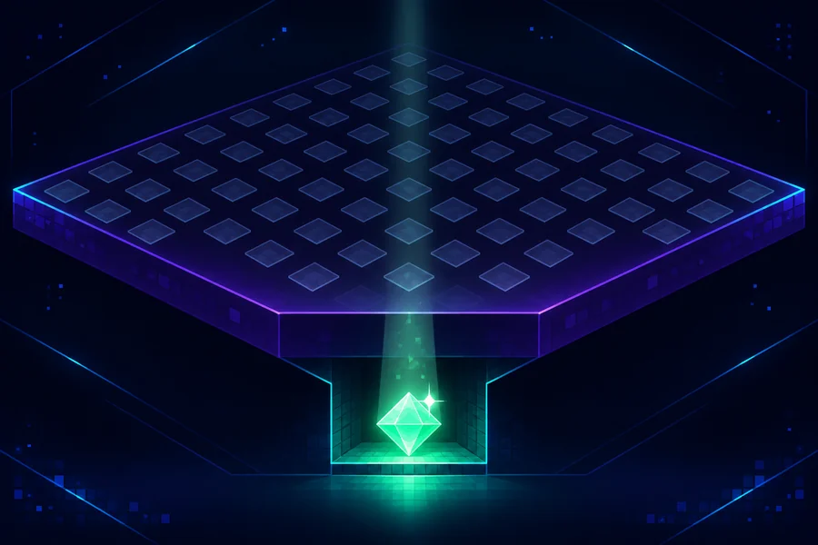

# GD Krillion Online

[Play the daily Geometry Dash trivia game](https://gdkrillion.online/#play) and see how your answers compare with what other players type.

- **Rare mode** rewards a correct answer that few players enter.
- **Crowd mode** rewards a correct answer that many players enter.
- **Play every day** with ten prompts about topics such as rated levels, music and the level editor.

## Learn the scoring before you play

Try the [sample answer reveal](https://gdkrillion.online/#practice) to see the same answers ranked in both modes. The sample uses invented answers, so you can switch modes without spoiling the daily set.

Read the [scoring guide](https://gdkrillion.online/guides/rare-vs-crowd/) for tips on choosing between two valid answers, or open the [daily strategy guide](https://gdkrillion.online/guides/daily-strategy/) for a routine to use when each prompt gives you thirty seconds.
